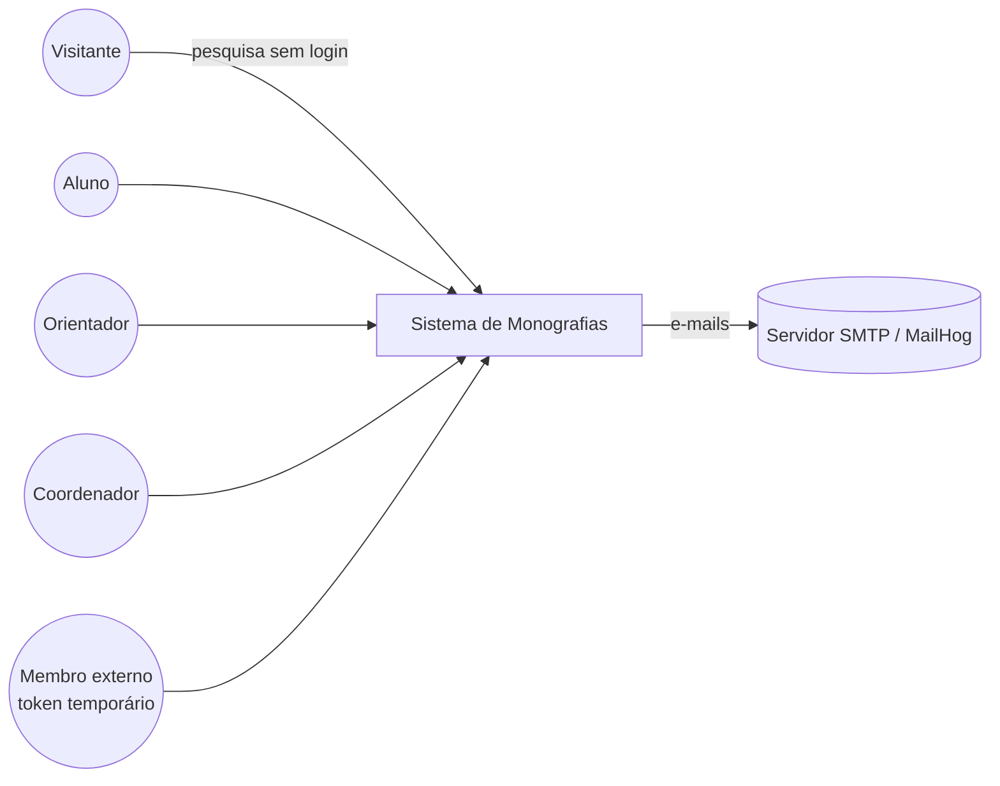
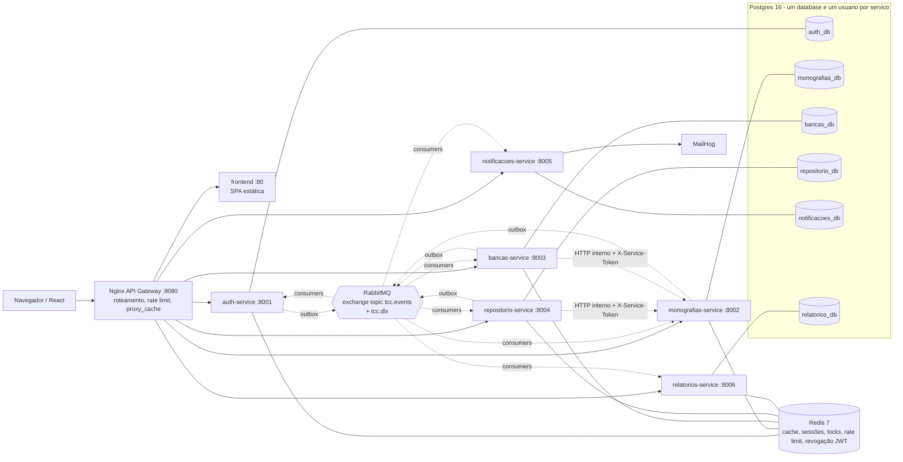
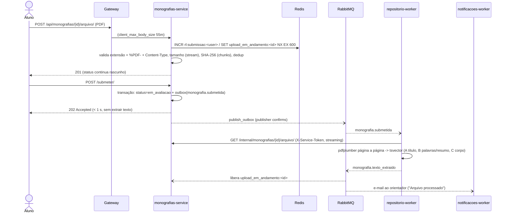
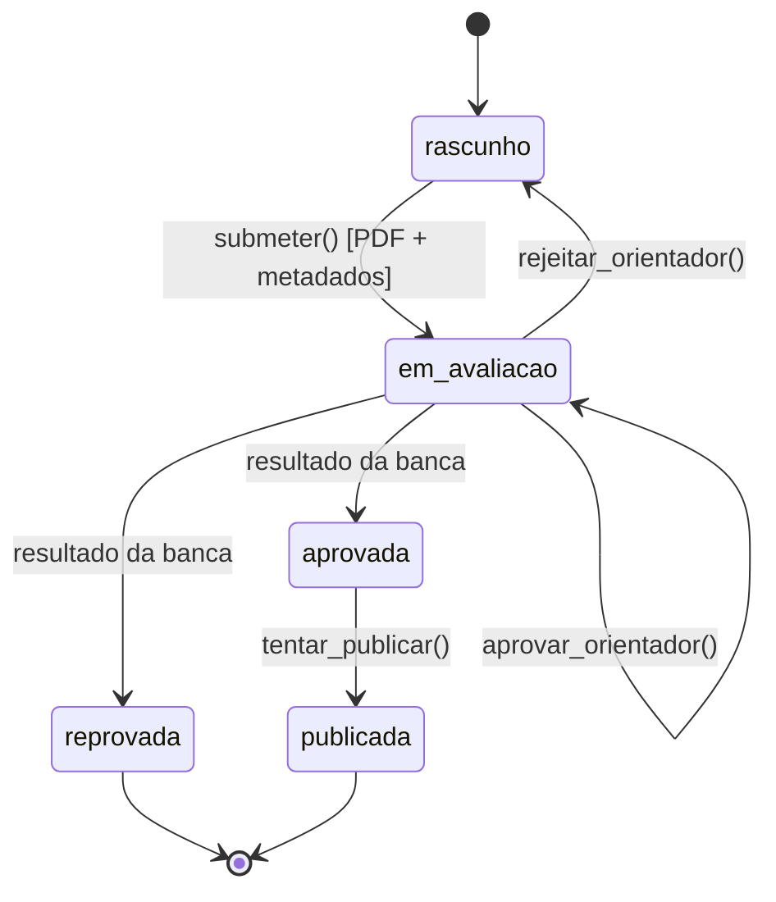

# Arquitetura

Sistema distribuído para cadastro, submissão, avaliação e publicação de monografias (TCC),
composto por **6 microsserviços Django independentes**, um **API Gateway Nginx**, um **frontend React**
e infraestrutura compartilhada (**PostgreSQL**, **Redis**, **RabbitMQ**, **MailHog**).

## 1. Contexto (C4 — nível 1)



## 2. Contêineres (C4 — nível 2)



Cada serviço roda como **3 processos** (containers): `<svc>-service` (Gunicorn/API), `<svc>-outbox`
(publisher `publish_outbox`) e `<svc>-worker` (`run_consumer`). O `monografias-cron` executa a
verificação diária de integridade.

| Serviço | Dono dos dados | Publica | Consome |
|---|---|---|---|
| auth | User, Curso, Professor, Aluno, RegistroAuditoria | `cadastro.*` | `audit.registro`, `monografia.integridade_violada` |
| monografias | Monografia, DocumentoComplementar | `monografia.*`, `documento.enviado`, `audit.registro` | `cadastro.#`, `banca.resultado_calculado`, `monografia.texto_extraido/extracao_falhou` |
| bancas | Banca, MembroBanca, Avaliacao | `banca.*`, `avaliacao.registrada` | `monografia.*`, `cadastro.professor.*`, `avaliacao.registrada` |
| repositorio | DocumentoIndexado, CursoRef, ProfessorRef | `monografia.texto_extraido/extracao_falhou`, `repositorio.indexado` | `monografia.submetida/publicada/excluida`, `cadastro.#` |
| notificacoes | Notificacao | — | eventos de monografia/banca, `cadastro.#` |
| relatorios | FatoMonografia | — | `monografia.*`, `banca.resultado_calculado`, `cadastro.#` |

## 3. Biblioteca compartilhada `libs/tcc_common`

| Módulo | Conteúdo |
|---|---|
| `auth` | validação local de JWT RS256 (chave por env/secret ou JWKS cacheado no Redis), `UsuarioToken`, permissões DRF (`IsAdmin`, `IsCoordenador`, `IsProfessor`, `IsAluno`, `IsDonoOuOrientador`, `ReadOnlyOrPublic`, `IsServicoInterno`) |
| `events` | envelope padrão + validação de schema (catálogo), modelos `OutboxEvento`/`EventoProcessado`, publisher com *confirms*, `BaseConsumer` (idempotência, ack pós-commit, retry 10 s/60 s/5 min, DLQ), comandos `publish_outbox`, `run_consumer`, `declarar_topologia` |
| `middleware` | `RequestIdMiddleware` (X-Request-ID) e `InstitutionalNetworkMiddleware` (IP/VPN) |
| `cache` | cliente Redis, rate limit (INCR+EXPIRE), locks `SET NX EX` |
| `audit` | `Historico()` (django-simple-history com usuário do JWT), diff legível, `HistoricoMixin` (`/historico/`), `registrar_auditoria` |
| `api` | exception handler `{"codigo","mensagem","detalhes"}`, paginação, healthchecks, logs JSON, router com barra opcional |
| `settings_base` | settings comuns (django-environ) — cada serviço só declara o que é próprio |
| `testing` | plugin pytest: chaves JWT de teste, clientes por papel, Redis falso, helpers de outbox/envelope |

## 4. Fluxos principais (sequência)

### 4.1 Submissão → extração assíncrona → notificação do orientador (fluxo exemplo do enunciado)



### 4.2 Agendamento em duas etapas e cálculo do resultado

```mermaid
sequenceDiagram
    actor C as Coordenador/Orientador
    participant B as bancas-service
    participant Q as RabbitMQ
    participant N as notificacoes
    participant M as monografias
    C->>B: POST /api/bancas (membros internos + externo)
    B->>B: valida aprovação do orientador (read model / HTTP interno)
    B--)Q: banca.convite_enviado (token externo só na mensagem; banco guarda SHA-256)
    Q--)N: e-mails de convite (/banca/externo/<token>)
    Note over B: membros confirmam (interno: JWT, externo: X-Banca-Token)
    C->>B: POST /api/bancas/{id}/agendar/
    B->>B: transação + pg_advisory_xact_lock por membro + checagem de sobreposição
    B--)Q: banca.agendada
    Q--)N: e-mail a TODOS os membros + aluno
    Note over B: após a defesa: marcar-realizada e avaliações
    B--)Q: avaliacao.registrada (a cada avaliação)
    Q--)B: consumer verifica count(avaliações) == count(membros) e calcula (lock, idempotente)
    B--)Q: banca.resultado_calculado
    Q--)M: registrar_resultado_banca() -> aprovada/reprovada
    Q--)N: aluno + orientador + coordenador
```

### 4.3 Publicação automática

```mermaid
sequenceDiagram
    actor A as Aluno
    actor C as Coordenador
    participant M as monografias-service
    participant Q as RabbitMQ
    participant R as repositorio
    A->>M: POST /documentos/ (termo assinado; versão corrigida se houve ressalvas)
    C->>M: POST /documentos/{doc}/validar-assinatura/
    M->>M: tentar_publicar(): aprovada + correção validada + termo validado + integridade OK
    M--)Q: monografia.publicada (metadados públicos)
    Q--)R: publico=true, cópia do PDF, reindexa, INCR busca:versao (invalida cache)
```

## 5. Máquina de estados da Monografia



O model impede `monografia.status = ...` fora dos métodos de domínio (o `save()` compara com o
status lido do banco e levanta `TransicaoInvalida` → HTTP 409).

## 6. Escalabilidade (resumo)

* Serviços **stateless** (sessões, cache, locks e revogação de JWT no Redis); mídia em volumes
  compartilhados (ver limitação em DECISOES.md).
* `docker compose up --scale repositorio-service=3 --scale repositorio-worker=3`: o Nginx (upstream
  com `resolve`) balanceia as réplicas; os workers competem na mesma fila (*competing consumers*).
* Três camadas de cache na leitura pública: Nginx `proxy_cache` (30 s, `proxy_cache_lock`), Redis
  `busca:<versao>:<hash>` (300 s, anti-stampede) e `Cache-Control`/`ETag` no cliente.
* Resultados medidos em [TESTE_DE_CARGA.md](TESTE_DE_CARGA.md).
